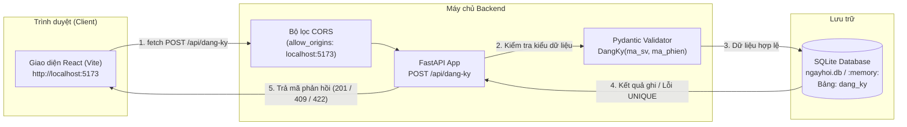
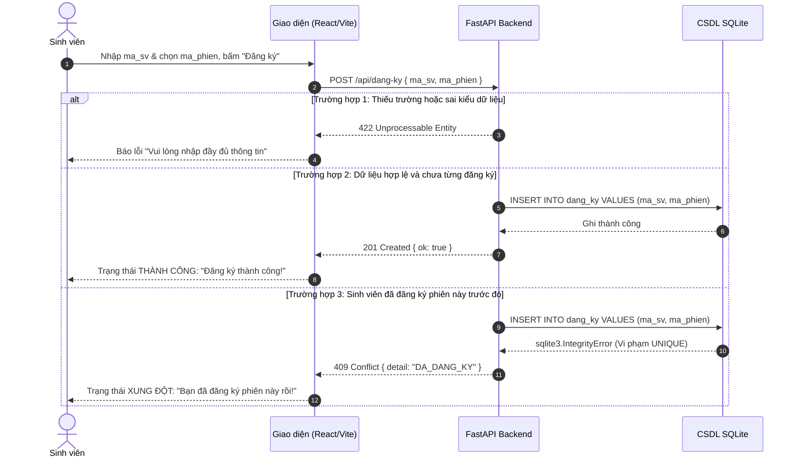

# Sơ Đồ Kiến Trúc & Luồng Hoạt Động Cổng Đăng Ký Ngày Hội Việc Làm

## 1. Sơ đồ Kiến trúc Hệ thống (Architecture Diagram)

## 2. Sơ đồ Tuần tự Chi tiết (Sequence Diagram)

## 3. Bảng Ánh Xạ Mã Phản Hồi (HTTP Status Codes)

| Mã HTTP | Tình huống | Thân phản hồi (JSON) | Phản hồi trên Giao diện |
|---|---|---|---|
| **201 Created** | Đăng ký thành công lần đầu | `{"ok": true}` | Thông báo màu xanh: "Đăng ký thành công!" |
| **409 Conflict** | Đã đăng ký phiên này trước đó | `{"detail": "DA_DANG_KY"}` | Thông báo màu vàng/đỏ: "Sinh viên đã đăng ký phiên này" |
| **422 Unprocessable** | Thiếu `ma_sv` hoặc `ma_phien` | `{"detail": [{"loc": [...], "msg": "Field required"}]}` | Thông báo cảnh báo dữ liệu không hợp lệ |
